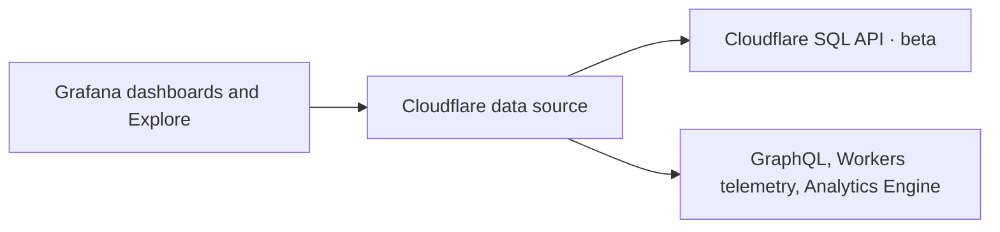
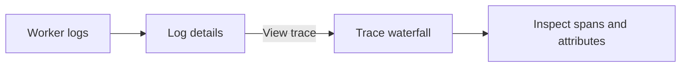

# Cloudflare data source for Grafana

Query and visualize Cloudflare metrics, logs, traces, and analytics in Grafana.

- **Metrics:** Workers, HTTP traffic, D1, R2, KV, Queues, Workers AI, and more.
- **Logs:** Search Workers and Containers logs, view context, and chart log volume.
- **Traces:** Search traces and open span waterfalls directly from logs.
- **Dashboards:** Use variables, annotations, alerts, and the included Cloudflare overview dashboard.



## Requirements

- Grafana **13.3+**.
- Your Cloudflare account ID and a [Cloudflare API token](#api-token-permissions) with permissions for the query languages, datasets, and resource selectors you use.
- To build: Node.js **24+**, pnpm, and Go **1.27.3+**.

### API token permissions

Create a custom token scoped to the accounts and zones you want to query. Start with **Account → Account Analytics → Read**, then add permissions for the features you use:

| Feature                                             | Token permission                                     | When to add it                                                                                                                                                  |
| --------------------------------------------------- | ---------------------------------------------------- | --------------------------------------------------------------------------------------------------------------------------------------------------------------- |
| SQL catalog, **Save & test**, and account analytics | **Account → Account Analytics → Read**               | Required for SQL dataset discovery and the connection test. Also used by GraphQL account analytics and the original Analytics Engine SQL API.                   |
| Account selector                                    | **Account → Account Settings → Read**                | Optional account metadata access for **Browse accounts**. You can enter an account ID directly instead.                                                         |
| Zone selector                                       | **Zone → Zone → Read**                               | Required for **Browse zones**. You can enter a zone ID directly instead. This permission doesn't grant access to analytics.                                     |
| **Workers telemetry** query language                | **Workers Observability Write** (account permission) | Add only if you use this query language. Cloudflare's telemetry query endpoint currently documents **Workers Observability Write**, even for retrieving events. |

For a token that supports analytics and both resource selectors, use the first three rows. Add the telemetry permission only when needed. **Workers Observability Read** isn't listed as an accepted permission for that telemetry endpoint. The Workers logs, Containers logs, and trace examples use the **SQL API**, so using those examples doesn't by itself require the telemetry permission.

SQL authorization also depends on the selected dataset and fields. Add their required product permissions; **Account Analytics Read** doesn't guarantee access to every product's data. For zone-scoped SQL queries, Cloudflare accepts **Zone → Analytics → Read** for the selected zones or **Account Analytics Read** for their owning account. Keep **Account Analytics Read** for this plugin's account-scoped catalog and connection test.

**Save & test** checks the SQL catalog, not every API or dataset. After saving, run a query for each feature you intend to use. Extra permissions don't enable a product, change its plan requirements, or restore data outside retention.

Sources: [SQL API authorization](https://developers.cloudflare.com/analytics/sql-api/get-started/), [GraphQL authentication](https://developers.cloudflare.com/analytics/graphql-api/getting-started/authentication/api-token-auth/), [Analytics Engine authentication](https://developers.cloudflare.com/analytics/analytics-engine/sql-api/#authentication), [token permission definitions](https://developers.cloudflare.com/fundamentals/api/reference/permissions/), [zone listing](https://developers.cloudflare.com/api/resources/zones/methods/list/), and [Workers telemetry query permissions](https://developers.cloudflare.com/api/resources/workers/subresources/observability/subresources/telemetry/methods/query/).

## Getting started

### 1. Build the plugin

```sh
git clone https://github.com/irvinebroque/grafana-cloudflare-datasource.git
cd grafana-cloudflare-datasource
pnpm install --frozen-lockfile
BUILD_ALL=1 pnpm exec vp run build
```

The installable plugin is in `dist/`. The build includes Linux, macOS, and Windows executables.

### 2. Install in Grafana

- Copy `dist/` to your Grafana plugins directory as `cloudflare-cloudflare-datasource/`.
- This plugin is **unsigned**. Add this to your Grafana configuration, then restart Grafana:

```ini
[plugins]
allow_loading_unsigned_plugins = cloudflare-cloudflare-datasource
```

### 3. Connect your account

1. Open **Connections → Data sources → Add data source**.
2. Select **Cloudflare**.
3. Enter your **API token** and **Default account ID**. Optionally add a default zone ID.
4. Click **Save & test**.
5. Open the data source's **Dashboards** tab and import **Cloudflare overview**.

Grafana encrypts the saved token. Cloudflare API requests run through the plugin backend.

## Query your data

### Use the query builder

1. Open **Explore** and select your Cloudflare data source.
2. Choose an example from **Start with**, or select a dataset and add metrics and filters.
3. Choose a time range and click **Run Cloudflare query**.

| What you want      | Example                     |
| ------------------ | --------------------------- |
| Requests by Worker | Workers · requests          |
| CPU time           | Workers · p99 CPU time (µs) |
| D1 query latency   | D1 · query latency (ms)     |
| R2 operations      | R2 · operations             |
| Worker logs        | Workers · logs              |
| Container logs     | Containers · logs           |
| Trace search       | Workers · distributed trace |

### Write SQL

Select **SQL** and **Time series**. This query charts requests for one Worker:

```sql
SELECT $__timeGroup(timestamp) AS time,
       COUNT(*) AS requests
FROM events.workersInvocations
WHERE scriptName = $worker
GROUP BY time
ORDER BY time
LIMIT 1000
```

Set **SQL parameters** to:

```json
{ "worker": "my-worker" }
```

- The plugin supplies the account or zone and dashboard time range. Omit those predicates from SQL.
- `$__timeGroup(timestamp)` groups results using Grafana's query interval.
- Press **Ctrl+Space** for dataset, column, macro, and dashboard variable suggestions. Press **Shift+Enter** or **Ctrl/Cmd+Enter** to run.
- Choose **Table** for queries without a time column.
- See the [Cloudflare SQL reference](https://developers.cloudflare.com/analytics/sql-api/sql-reference/) for supported functions.

### Explore logs and traces

- Choose **Workers · logs** or **Containers · logs** to search logs and view surrounding context.
- In builder log details, use the filter buttons to include or exclude a field value. The builder shows the resulting filter.
- In Worker log details, click **View trace** to open the matching waterfall.
- Choose **Workers · distributed trace** to search traces, or paste a **Trace ID**.



### Use other Cloudflare APIs

| Query language           | How to use it                                                                                                                                       |
| ------------------------ | --------------------------------------------------------------------------------------------------------------------------------------------------- |
| **GraphQL**              | Start with the included Workers query; set the result data path and time column. Set an operation name when the document contains multiple queries. |
| **Workers telemetry**    | Paste a Query Builder request; use `events.events` as the result path for logs.                                                                     |
| **Analytics Engine SQL** | Replace `your_dataset` in the starter query; keep its explicit time filter.                                                                         |

## Run locally with Docker

After building the plugin:

```sh
export CLOUDFLARE_API_TOKEN='your-token'
export CLOUDFLARE_ACCOUNT_ID='your-account-id'
docker compose up
```

Open [localhost:3100](http://localhost:3100) and sign in with `admin` / `admin` on first use.

## Things to know

- Dataset access depends on your token, Cloudflare plan, and data retention.
- Sampling can affect metrics and leave gaps in logs or traces.
- A row-limit warning means results may be incomplete; narrow the time range or increase the limit.
- See [validation and known limitations](docs/VALIDATION.md).
- See [platform coverage and remaining gaps](docs/COVERAGE.md). The SQL dataset validation count is not a percentage of Cloudflare platform coverage.
- See the [0.1.1 bug audit](docs/AUDIT.md) for fixes and dependency findings.
- See the [comparison with Grafana's cloud datasources](docs/COMPARISON.md) for the design decisions behind the editor and Explore integrations.

## Development

Uses Vite Plus, strict TypeScript, and [anti-slop](https://github.com/dmmulroy/anti-slop).

```sh
pnpm exec vp check --deny-warnings
pnpm exec vp test run
go test -race ./...
pnpm exec vp run build
```

Use `pnpm exec vp run dev` for incremental frontend builds. Initial and subsequent builds emit Grafana-compatible SystemJS modules. Rebuild the Go executable and restart Grafana after backend changes.

## License

[Apache 2.0](LICENSE).
